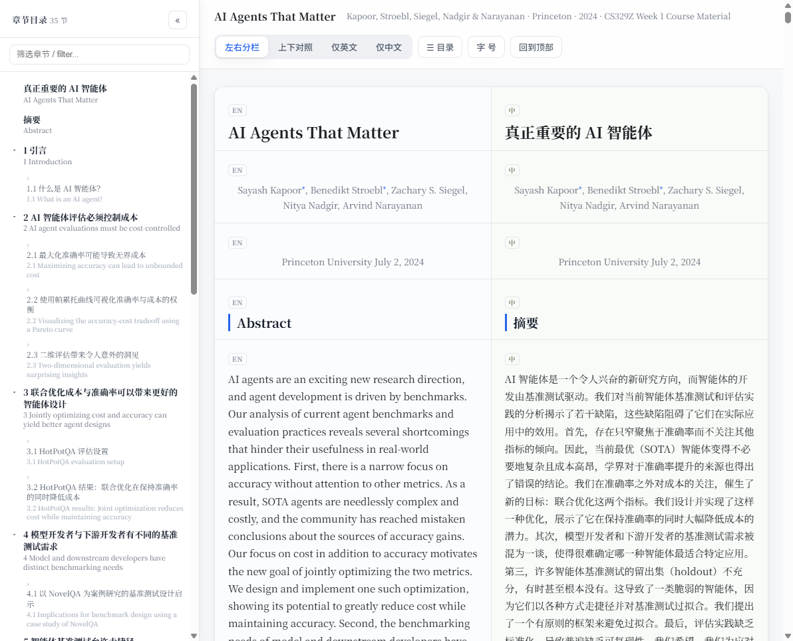

# skillshub

可复用的 Agent Skill 集合。当前收录 **2 个 skill** · **v1**。

## 目录

- [收录](#收录)
- [效果示意](#效果示意)
- [Skill 介绍](#skill-介绍)
  - [anything-to-wechat-article](#anything-to-wechat-article)
  - [pdf-to-html](#pdf-to-html)
- [安装](#安装)
- [快速开始](#快速开始)
  - [公众号排版](#公众号排版)
  - [PDF 转双语网页](#pdf-转双语网页)

## 收录

| Skill | 用途 | 目录 |
|---|---|---|
| `anything-to-wechat-article` | 把任意来源整理成微信公众号排版文章 | [`skills/anything-to-wechat-article/`](skills/anything-to-wechat-article/) |
| `pdf-to-html` | 把论文 PDF 转成可全文阅读的英中双语对照网页 | [`skills/pdf-to-html/`](skills/pdf-to-html/) |

## 效果示意

**anything-to-wechat-article**：用仓库内的示例 IR 渲染，内容均为虚构演示数据；全内联样式 HTML + 自制中文信息图，无生图工具。


**pdf-to-html**：论文 PDF 转成的双语对照网页首屏——左侧可折叠两级目录，正文左右分栏（EN／中），顶栏含模式切换与阅读设置。



## Skill 介绍

### anything-to-wechat-article

- **输入**：X 推文／长文／视频、网页、PDF、Word、Markdown、音频、播客、会议记录、截图或粘贴文本。
- **输出**：全内联样式 HTML、独立 PNG、Markdown 存档、逐字稿（如有）、来源与整理说明。
- **流程**：只读调研 → 由人拍板口径与主题 → 采集 → 写成 IR → 代码画图 → 主题排版 → CI 门禁。
- **特点**：六套内置主题（可按主色派生）、配图一律 HTML/CSS 渲染成 2× PNG、32 条可机器判定的规则（结构 / 内容 / 图内文本）、规则与本次任务冲突时交人裁决。

### pdf-to-html

- **输入**：论文 PDF 或 arXiv 链接。
- **输出**：自包含双语 HTML——左右分栏／上下对照／仅英／仅中四种模式，保留图片表格，带可折叠目录、引用悬浮预览、图片全屏缩放、字号滑块与中文字体切换。
- **流程**：环境预检（自动检查项目 Python 与 MinerU key，缺失则创建/引导）→ MinerU 转换 → 分块翻译 → 对照原 PDF 校验并构建 HTML → 静态门禁 + 浏览器门禁。
- **特点**：把 19 条真实踩坑固化为机器约束（27 项静态检查 + 9 项 Chrome headless 交互测试）；零厂商生态依赖，Python 3 + 任意浏览器即可运行。详见 [`SKILL.md`](skills/pdf-to-html/SKILL.md) 与 [`踩坑清单`](skills/pdf-to-html/references/pitfalls.md)。

## 安装

不同 Agent 的 skill 目录位置不同，把所需 skill 的**整个目录**放到你所用 Agent 的用户级 skills 目录即可；也可以使用仓库外单独提供的 `.skill` 分发包。

安装后以该 skill 的 `SKILL.md` 为准；首次使用时的解释器判定规则也写在里面。

## 快速开始

### 公众号排版

```bash
python scripts/build_article.py --list-themes
python scripts/check_themes.py
python scripts/ci_check.py --html dist/wechat-article.html --md dist/article.md \
  --ir content.json --theme ink-tangerine --out dist
```

### PDF 转双语网页

```bash
# 0) 环境预检（缺 Python 配置/MinerU key 时按提示创建，key 需自行提供）
python skills/pdf-to-html/scripts/setup_env.py --workdir . --init

# 1) MinerU 转换（token 也可放环境变量 MINERU_API_TOKEN）
python skills/pdf-to-html/scripts/mineru_convert.py --url https://arxiv.org/pdf/XXXX.XXXXX --out temp/mineru_out

# 2) 分块 / 翻译 / 构建：见 SKILL.md 的 S3-S5

# 3) 双门禁
python skills/pdf-to-html/scripts/validate.py . --strict
python skills/pdf-to-html/scripts/browser_test.py courses/<章节>/CourseMaterial/<论文>/<论文>_bilingual.html
```
