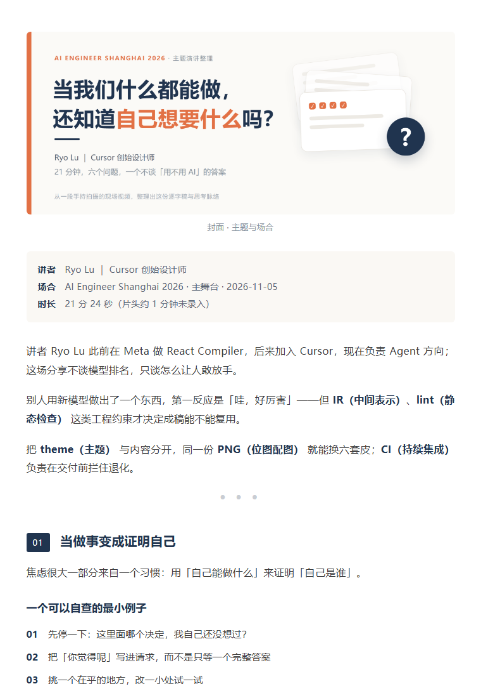

# skillshub

可复用的 Agent Skill 集合。当前收录 **1 个 skill** · **v1**。

## 收录

| Skill | 用途 | 目录 |
|---|---|---|
| `anything-to-wechat-article` | 把任意来源整理成微信公众号排版文章 | [`skills/anything-to-wechat-article/`](skills/anything-to-wechat-article/) |

## 效果示意



> 用仓库内的示例 IR 渲染，内容均为虚构演示数据；全内联样式 HTML + 自制中文信息图，无生图工具。

## 这个 skill 做什么

- **输入**：X 推文／长文／视频、网页、PDF、Word、Markdown、音频、播客、会议记录、截图或粘贴文本。
- **输出**：全内联样式 HTML、独立 PNG、Markdown 存档、逐字稿（如有）、来源与整理说明。
- **流程**：只读调研 → 由人拍板口径与主题 → 采集 → 写成 IR → 代码画图 → 主题排版 → CI 门禁。
- **特点**：六套内置主题（可按主色派生）、配图一律 HTML/CSS 渲染成 2× PNG、32 条可机器判定的规则（结构 / 内容 / 图内文本）、规则与本次任务冲突时交人裁决。

## 安装

不同 Agent 的 skill 目录位置不同，把 `skills/anything-to-wechat-article/` **整个目录**放到你所用 Agent 的用户级 skills 目录即可；也可以使用仓库外单独提供的 `.skill` 分发包。

安装后以该 skill 的 [`SKILL.md`](skills/anything-to-wechat-article/SKILL.md) 为准；首次使用时的解释器判定规则也写在里面。

## 快速开始

```bash
python scripts/build_article.py --list-themes
python scripts/check_themes.py
python scripts/ci_check.py --html dist/wechat-article.html --md dist/article.md \
  --ir content.json --theme ink-tangerine --out dist
```

